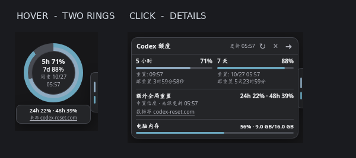

# Codex Quota Monitor — v1.6.0

**An unofficial dockable two-ring quota orb for split-screen ChatGPT use in Edge / Chrome.**

[中文安装与说明 / Chinese instructions](README.zh-CN.md) · [Forecast methodology and caveats](docs/FORECAST_METHOD.md)

MIT licensed · No affiliation with OpenAI or the forecast data provider.



*Illustrative Playwright screenshot using mock data, not a real account.*

## New in v1.6.0

- **Docked:** a 13px edge handle, with almost no persistent screen footprint. Transparent widget areas don't intercept page clicks.
- **Hover:** a 100px two-ring orb showing **5h remaining**, **7d remaining**, and **7d reset date/time**. Experimental third-party 24h/48h extraordinary global reset estimates appear only on hover, with source attribution.
- **Click orb:** a compact 282px detail popup with both reset countdowns, source status, and whole-PC RAM readings. Click outside, press `Esc`, or use the collapse control to dock it.
- **RAM > 90%:** a small red RAM badge appears in the hover orb; otherwise RAM is omitted there (but always available in details). Color-only quota risk indicators, no system notifications, popups, sound, or automatic cleanup.
- **Per-tab:** each tab retains its own show/hide state and edge location. `Ctrl+Alt+Q` remains the explicit hide/reopen toggle. You can drag the handle or detail title to change edge/height, or double-click the detail title to reset.
- **Forecast fetch:** prefers the permission-limited extension background service and falls back to a read-only page fetch when possible, with bounded retries and shared short-term caching.

## Quick installation

1. Install and enable **Tampermonkey** in Edge/Chrome.
2. Download and unzip the [v1.6.0 installation package](dist/codex-quota-monitor-v1.6.0-install.zip). In Tampermonkey, **disable the previous version**, then import `Codex_Quota_Bars_Web_CN_v1.6.user.js` from the package.
3. Already have the **v1.5 RAM & forecast companion extension**? You may keep it installed; v1.6 uses the same RAM and forecast messaging protocols and host permissions.
4. For first-time installation of optional PC RAM and reliable forecast fallback, enable Developer mode at `edge://extensions` or `chrome://extensions`, then **Load unpacked** and choose `Edge_RAM_Forecast_Bridge_v1.6/` from the extracted ZIP. The folder must contain `manifest.json`.
5. Refresh [chatgpt.com](https://chatgpt.com/), hover the narrow side handle, then click the orb to inspect details. If the overlay had been explicitly closed in that tab, press `Ctrl+Alt+Q` to reopen it.

You can use the quota-only feature without the companion. Reading physical RAM requires the companion; the experimental forecast may fail when page security policy blocks cross-origin requests.

## What the data means

- Quota percentages and reset timestamps are read from the logged-in user's first-party `/backend-api/wham/usage` endpoint. This is undocumented and may change.
- **Forecast**: `GET https://codex-reset.com/api/forecast`, using only the public fields `probabilities.rounded_24h`, `rounded_48h`, `updated_at` and `confidence`. These probabilities concern *possible unscheduled global Codex quota top-ups*, **not** your ordinary 5-hour/7-day refresh, and **not** banked reset credits. They are experimental third-party estimates and **not a promise or an official forecast**. Attribution and a source link are visible alongside any estimates.
- Forecast data is rejected when missing, inconsistent or stale. Successes are cached for around 20 minutes; shared source/cached freshness checks remain in place. If the source is inaccessible, the widget states this instead of inventing values. **Opening the provider website manually should not normally be necessary**, but background fetching cannot bypass the provider's own outages, challenges, or network restrictions.
- RAM is whole-PC physical usage estimated from `capacity - availableCapacity`, which can differ slightly from Windows Task Manager. It is not per-tab or per-process memory usage.

## Refresh and privacy

- Usage: approximately every 2 minutes while the tab is visible and the widget isn't explicitly hidden, with best-effort shared cache/lock across ChatGPT tabs.
- RAM: approximately every 30 seconds in the same conditions.
- Forecast: uses a 20-minute success interval, bounded failure retry delays, best-effort cross-tab lock and a minimum 1-minute request gap. No proactive fetching when the widget is explicitly closed.
- Forecast GET carries **no ChatGPT credentials, quota values, RAM values, chat content or account IDs**. It uses `credentials:'omit'` and no referrer. The provider necessarily sees the public IP and normal HTTPS request metadata.
- The optional MV3 extension uses only `system.memory`, `https://codex-reset.com/*`, and a content script confined to `https://chatgpt.com/*`. No analytics or telemetry is added.

## Repo layout / testing

```text
userscript/                     Userscript v1.6
edge-extension/                 MV3 RAM and forecast companion (compatible with v1.5)
tests/                          Node checks + Playwright simulated UI test
docs/FORECAST_METHOD.md         Source semantics and prediction limitations
dist/                           Prebuilt installation ZIP and SHA-256 hashes
.github/workflows/             CI source syntax and bridge contract checks
README.zh-CN.md                 Chinese installation instructions
LICENSE                         MIT License
```

Run:

```bash
node --check userscript/Codex_Quota_Bars_Web_CN_v1.6.user.js
node tests/manifest.test.cjs
node tests/bridge.test.cjs
# optional Chromium + Playwright environment
python tests/browser.test.py
```

**Test limitations:** browser UI tests use mocked quota, forecast, and RAM values; they do not demonstrate successful real-world source access on every account/network. The downloaded userscript is not an official OpenAI extension. Don't post tokens, cookies, or private chats in public issues. See [SECURITY.md](SECURITY.md) and [CONTRIBUTING.md](CONTRIBUTING.md).
